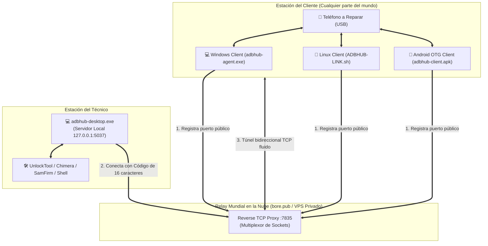

# ADBHUB-LINK v2.0 🌐⚡

[](https://www.rust-lang.org/)
[](https://developer.android.com/)
[](https://ubuntu.com/)
[](https://microsoft.com)
[](#)

> **Plataforma profesional y multiplataforma de puente ADB y Passthrough USB remoto para laboratorios GSM y soporte técnico mundial.**

Conecta dispositivos móviles Android desde cualquier parte del mundo directamente al entorno de trabajo del técnico **sin necesidad de VPN, sin abrir puertos en el router (Zero NAT/Firewall) y sin consolas emergentes**. 

Compatible con todas las herramientas profesionales de servicio técnico (UnlockTool, Chimera Tool, SamFirm, Hydra, Miracle Box, Z3X, QFIL, SP Flash Tool y Android Debug Bridge).

---

## 📑 Tabla de Contenidos

1. [Características Principales](#-características-principales)
2. [Arquitectura y Protocolo](#-arquitectura-y-protocolo)
3. [Ecosistema Multiplataforma (DIST-RELEASES)](#-ecosistema-multiplataforma-dist-releases)
4. [Guía Rápida de Uso](#-guía-rápida-de-uso)
   - [Windows (Técnico y Cliente)](#1-windows-plug--play)
   - [Linux (Script Inteligente)](#2-linux-lubuntu--ubuntu--debian)
   - [Android (Cable USB-C OTG sin PC)](#3-android-puente-otg-celular-a-celular)
5. [Compilación desde el Código Fuente](#-compilación-desde-el-código-fuente)
6. [Estructura del Proyecto](#-estructura-del-proyecto)
7. [Seguridad y Privacidad](#-seguridad-y-privacidad)

---

## 🚀 Características Principales

* **🌍 Conectividad Global Inmediata (Zero-Config Relay)**: Utiliza un túnel inverso TCP en la nube (`bore.pub`) para atravesar routers, firewalls corporativos y CGNAT de datos móviles (4G/5G). Funciona mundialmente con solo compartir un código.
* **🔑 Emparejamiento por Código Tipo AnyDesk**: Código criptográfico autolocalizable de 16 caracteres (`XXXX-XXXX-XXXX-XXXX`) o 9 dígitos (`NNN-NNN-NNN`) que empaqueta en 8 bytes la IP local y el puerto del relay mundial. No requiere bases de datos centralizadas.
* **⚡ Soporte Android Celular a Celular (USB-C OTG)**: Si el cliente no tiene computadora, puede conectar el teléfono a reparar a otro celular Android mediante un cable USB-C a USB-C normal usando nuestra APK nativa.
* **🔇 Modo Silencioso 100% Nativo (Zero Popups)**: Eliminación total de parpadeos de consolas CMD (`CREATE_NO_WINDOW (0x08000000)` en Windows y modo servicio daemon en Linux).
* **🎨 Interfaz Gráfica Profesional Dark Slate**: Diseñada en Rust con `egui` (Windows) y Tkinter nativo (Linux), completamente responsiva con scrollbars fluidos para adaptarse desde laptops de 1366x768 hasta monitores 4K.
* **🛡️ Plataforma Oficial Google ADB v36**: Empaquetado con los binarios oficiales limpios de Android SDK Platform-Tools para evitar fallos de memoria `0xc0000005`.

---

## 🛠️ Arquitectura y Protocolo



### ¿Cómo funciona el Código de Estación?
El código generado (ej. `8924-BE29-19BC-30DB`) contiene una estructura binaria de 8 bytes ofuscada con clave XOR y magic byte `0xAD`:
- **Byte 0**: Magic Byte + Firma (`0xAD ^ Salt`).
- **Byte 1**: Salt dinámico (cambia con el botón "Nuevo ID").
- **Bytes 2..5**: Octetos de la IP de red local LAN (`192.168.x.x`).
- **Bytes 6..7**: Puerto TCP público asignado en el Relay Mundial (0 a 65535).

---

## 📦 Ecosistema Multiplataforma (`DIST-RELEASES`)

Los ejecutables finales de producción se compilan y organizan de forma limpia en la carpeta [`DIST-RELEASES/`](DIST-RELEASES/):

```text
DIST-RELEASES/
├── Android-Cliente/       # Para clientes sin PC (Teléfono a Teléfono)
│   ├── adbhub-client.apk  # APK nativa firmada v2/v3 para Android 7.0+
│   └── INSTRUCCIONES.txt
├── Linux-Cliente/         # Para clientes o servidores en Linux (Ubuntu/Debian)
│   ├── ADBHUB-LINK.sh     # Script autoconfigurable todo-en-uno
│   ├── adbhub-client.py   # Motor puente con interfaz Dark Slate
│   └── INSTRUCCIONES.txt
├── Windows-Cliente/       # Para el cliente final en Windows (Plug & Play)
│   ├── adbhub-agent.exe   # GUI del cliente en Rust (sin consolas)
│   ├── adb.exe            # Google Platform-Tools v36 oficial
│   ├── AdbWinApi.dll
│   ├── AdbWinUsbApi.dll
│   └── INSTRUCCIONES.txt
└── Windows-Tecnico/       # Para el técnico especialista
    ├── adbhub-desktop.exe # Suite de control, terminal y monitoreo
    ├── adb.exe
    ├── AdbWinApi.dll
    ├── AdbWinUsbApi.dll
    └── INSTRUCCIONES.txt
```

---

## 📖 Guía Rápida de Uso

### 1. Windows (Plug & Play)
* **Técnico**: Ejecute `adbhub-desktop.exe`. Pegue el código recibido y presione **Conectar**.
* **Cliente**: Descomprima `Windows-Cliente`, ejecute `adbhub-agent.exe`, conecte el teléfono por USB con Depuración activa y comparta el código que aparece en pantalla.
* *(No requiere instalar drivers extras ni dependencias previas).*

### 2. Linux (Lubuntu / Ubuntu / Debian)
En la carpeta `Linux-Cliente`, abra una terminal y ejecute:
```bash
bash ADBHUB-LINK.sh
```
* **Autodetección inteligente**: Si es la primera vez, el script instala automáticamente `adb` y `python3-tk`, configura las reglas `udev`/`plugdev` para acceso USB sin `sudo` y crea el acceso directo en el Escritorio.
* **Siguientes ejecuciones**: Inicia la aplicación gráfica en menos de un segundo.

### 3. Android (Puente OTG Celular a Celular)
Ideal cuando el cliente no tiene computadora:
1. Instale `adbhub-client.apk` en el **Celular A** (el que servirá de puente con internet Wi-Fi o 4G/5G).
2. Conecte un cable **USB-C a USB-C** (o adaptador OTG) desde el Celular A hacia el **Celular B** (el equipo a reparar con Depuración USB activa).
3. En el Celular A, acepte el permiso USB Host cuando la app lo solicite.
4. El Celular A generará el **Código de Estación Mundial**. Envíelo al técnico para trabajar de forma remota.

---

## 🔨 Compilación desde el Código Fuente

### Requisitos Previos
* **Rust**: `1.80+` (`rustup default stable`)
* **Java JDK**: `OpenJDK 21+`
* **Android SDK**: `build-tools 34.0.0+` y `platforms/android-34`
* **Python**: `3.10+` (solo para el cliente Linux de Tkinter)

### Compilar Ejecutables de Windows (Técnico y Agente)
```powershell
# Compilar binarios optimizados en Release
cargo build --release -p adbhub-agent -p adbhub-desktop

# Copiar ejecutables a las carpetas de distribución
Copy-Item "target/release/adbhub-agent.exe" "DIST-RELEASES/Windows-Cliente/adbhub-agent.exe"
Copy-Item "target/release/adbhub-desktop.exe" "DIST-RELEASES/Windows-Tecnico/adbhub-desktop.exe"
```

### Compilar y Firmar el APK de Android
```powershell
# Ejecuta el compilador automatizado (aapt2, javac, d8, zipalign, apksigner)
powershell -ExecutionPolicy Bypass -File "apps/adbhub-android/build-apk.ps1"
```
El instalador firmado quedará listo en `DIST-RELEASES/Android-Cliente/adbhub-client.apk`.

### Ejecutar Pruebas Unitarias
```bash
cargo test --workspace
```

---

## 📁 Estructura del Proyecto

```text
ADBHUB-LINK/
├── apps/
│   ├── adbhub-agent/          # GUI del Cliente Windows en Rust (egui)
│   ├── adbhub-desktop/        # GUI del Técnico en Rust (egui multi-panel)
│   └── adbhub-android/        # Código fuente nativo Java de la app Android OTG
├── crates/
│   ├── core/                  # Motor ADB, codificación AnyDesk y túnel bore
│   ├── usb-enumerator/        # Escaneo y detección de hardware USB local
│   ├── usb-discovery/         # Filtro inteligente de marcas GSM (Samsung, MTK, EDL)
│   ├── usbip-adapter/         # Adaptador USB/IP para passthrough
│   └── ...                    # Módulos de transporte seguro y protocolo
├── DIST-RELEASES/             # Entregables listos para producción
└── Cargo.toml                 # Workspace de Rust
```

---

## 🔒 Seguridad y Privacidad

1. **Aislamiento de Puertos USB**: El cliente solo expone hacia el túnel el puerto ADB del teléfono seleccionado, protegiendo todos los demás periféricos (teclados, webcams, discos externos) de la máquina anfitriona.
2. **Autorización Criptográfica RSA**: Todo comando enviado por el técnico requiere la autorización explícita de la huella RSA en la pantalla física del teléfono móvil a reparar.
3. **Cero Retención de Datos**: El túnel `bore` actúa como un conducto de memoria volátil (`TCP pipe`), sin almacenar información, comandos ni archivos en el servidor intermedio.

---

<div align="center">
  <sub>Desarrollado con arquitectura nativa de alto rendimiento para la comunidad técnica de soporte y reparación móvil.</sub>
</div>
