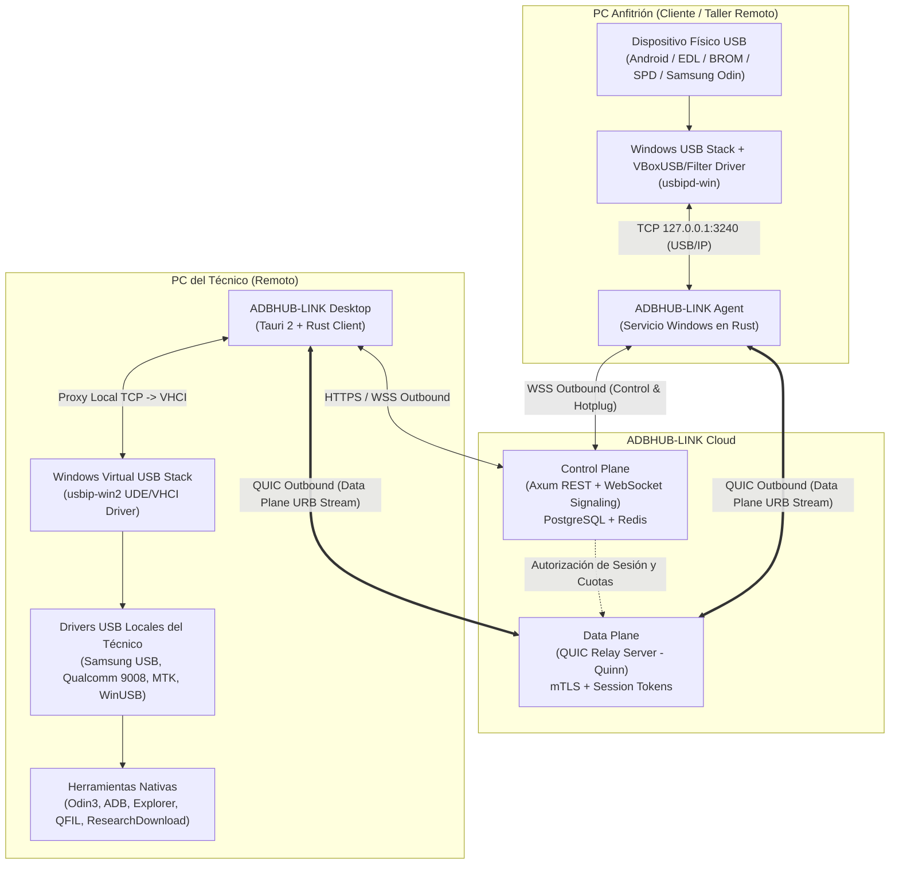

# ADBHUB-LINK — Arquitectura General

## 1. Visión Arquitectónica

**ADBHUB-LINK** es una plataforma comercial de transporte USB passthrough remoto multiprotocolo entre equipos Windows a través de Internet. A diferencia de los wrappers de comandos ADB o soluciones que comparten únicamente puertos COM virtuales, ADBHUB-LINK transporta paquetes USB de bajo nivel (URBs encapsulados mediante el protocolo USB/IP v1.1.1 sobre flujos QUIC autenticados y multiplexados) permitiendo que el sistema operativo Windows del técnico enumere el dispositivo remoto en su propio stack USB virtual (UDE/VHCI) y cargue los controladores locales del fabricante.

Esto habilita el funcionamiento transparente de:
- **ADB** (`adb.exe` ejecutándose localmente en el equipo del técnico).
- **MTP** (Windows Portable Devices / Explorador de Windows local).
- **Qualcomm EDL** (Qualcomm HS-USB QDLoader 9008 `05C6:9008`).
- **MediaTek BROM / Preloader** (`0E8D:0003`, `0E8D:2000`, etc.).
- **SPD / Spreadtrum / Unisoc** (`1782:4D00` y variantes).
- **Samsung Download Mode (Odin / Loke)** (`04E8:685D`, `04E8:6601`, `04E8:68C3`).

---

## 2. Separación entre Control Plane y Data Plane

### 2.1 Control Plane
Responsable de la identidad, permisos, inventario de dispositivos, ciclo de vida de sesiones, señalización de reenumeraciones y auditoría:
- **Autenticación y Autorización**: JWT de corta duración + Refresh Tokens rotativos para usuarios; llaves públicas Ed25519 / mTLS para agentes.
- **Device Registry & Broker**: Mantiene el estado en tiempo real de los dispositivos conectados a cada agente (`DISCOVERED`, `AVAILABLE`, `SHARED`, `ACTIVE`, `REENUMERATING`, etc.).
- **Signaling WebSocket (`/ws/agent`, `/ws/desktop`, `/ws/session/{id}`)**: Notifica eventos de conexión/desconexión física, solicitud/aprobación de acceso, revocación inmediata y transiciones de modo USB (ej. paso de Android normal a Samsung Download Mode).
- **Auditoría**: Registra metadatos de sesión (quién, qué dispositivo, cuándo, transiciones de estado) sin inspeccionar ni almacenar jamás payloads USB ni datos privados del teléfono.

### 2.2 Data Plane
Responsable exclusivamente del transporte binario de baja latencia y alta confiabilidad de mensajes `OP_REQ_DEVLIST`, `OP_REQ_IMPORT`, `USBIP_CMD_SUBMIT`, `USBIP_RET_SUBMIT`, `USBIP_CMD_UNLINK` y `USBIP_RET_UNLINK`:
- **Conexiones 100% Salientes (Outbound QUIC)**: Ni la PC anfitriona ni la PC del técnico requieren abrir puertos en su firewall o router (NAT traversal nativo mediante Relay QUIC).
- **Aislamiento por Sesión**: Cada sesión aprobada recibe un token criptográfico efímero que vincula un stream bidireccional QUIC del Agente con el stream del Técnico en el Relay.
- **Control de Flujo y Backpressure**: Límites estrictos de memoria en buffers en vuelo para evitar saturación durante volcados de particiones grandes (ej. `super.img` o `AP` en Odin).
- **Protección de Operaciones Críticas**: Timeouts diferenciados por tipo de transferencia y modo del dispositivo (ej. borrado de flash o escritura de bloques grandes en Samsung Download Mode).

---

## 3. Estructura Modular del Workspace

El repositorio se organiza siguiendo una arquitectura limpia en Rust:

1. **`crates/core`**: Tipos de dominio fundamentales (`UsbDeviceDescriptor`, `InterfaceDescriptor`, `EndpointDescriptor`, `UsbDeviceMode`, `DeviceLifecycleState`, `BusId`, `VidPid`, errores tipados y clasificación heurística multiprotocolo).
2. **`crates/usb-discovery`**: Orquestador de descubrimiento USB, cálculo de huella lógica (`LogicalDeviceIdentity`) e identificación del modo operativo del teléfono.
3. **`crates/usb-enumerator`**: Interacción nativa con Windows SetupAPI / Configuration Manager (`CfgMgr32`) y parseo binario de descriptores USB estándar (USB 2.0/3.0 Specification Capítulo 9) + integración con el estado de `usbipd-win`.
4. **`crates/usb-monitor`**: Monitor asíncrono de eventos hotplug y el **Device Lifecycle Manager**, encargado de rastrear desconexiones y reenumeraciones (por ejemplo, cuando un teléfono se reinicia en modo Bootloader/Download/EDL en el mismo puerto físico) manteniendo la sesión lógica activa.
5. **`apps/adbhub-agent`**: Servicio/ejecutable Windows del lado anfitrión que integra el descubrimiento, monitoreo de ciclo de vida y telemetría estructurada.

