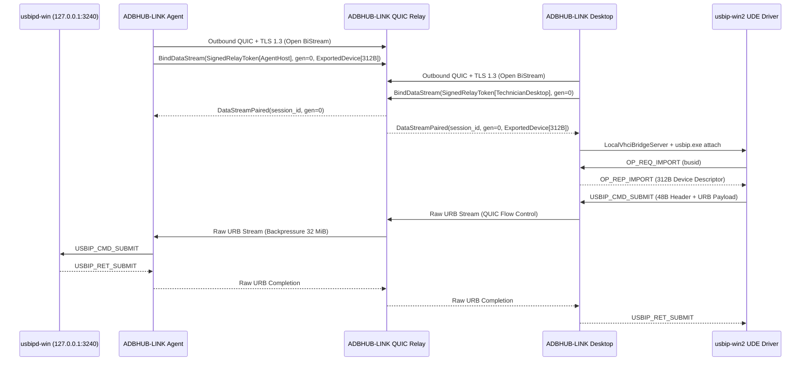

# Especificación del Protocolo de Relay QUIC (`adbhub-relay-v1`)

## 1. Arquitectura de Conexión Saliente (Zero Inbound Ports)

Tanto **ADBHUB-LINK Agent** (en el equipo Windows donde está conectado el teléfono) como **ADBHUB-LINK Desktop** (en el equipo Windows del técnico) establecen conexiones salientes UDP sobre **QUIC + TLS 1.3** (`ALPN = "adbhub-relay-v1"`) hacia el servidor **ADBHUB-LINK Relay**.

---

## 2. Seguridad, Autenticación y Protección Anti-Replay

1. **Tokens Efímeros Firmados (`SignedRelayToken`)**:
   - Cada flujo de datos requiere un token firmado con `HMAC-SHA256` que contiene:
     - `session_id`: UUID de la sesión autorizada.
     - `role`: `AgentHost` o `TechnicianDesktop`.
     - `peer_id`: UUID del Agente o Técnico.
     - `bus_id`: Puerto topológico autorizado (ej. `1-4`).
     - `nonce`: UUID v4 único de 128 bits.
     - `issued_at_unix` y `expires_at_unix`: Ventana temporal estricta.
2. **Protección Anti-Replay**:
   - El Relay mantiene un registro de `nonce` utilizados y rechaza inmediatamente con `TOKEN_REPLAY_DETECTED` cualquier intento de reutilizar un token interceptado o duplicado.
3. **Revocación Inmediata (`RevokeSession`)**:
   - Si el propietario del equipo anfitrión o el administrador revoca la sesión, el Relay invalida `session_id` en su tabla de sesiones revocadas y descarta cualquier stream pendiente o futuro.
4. **Privacidad de Datos**:
   - El Relay **no almacena** ningún paquete USB ni payload de transferencia en disco o base de datos; únicamente registra contadores agregados (`urbs_completed`, `bytes_out_to_device`, `bytes_in_from_device`).

---

## 3. Parámetros QUIC para Operaciones de Flasheo Prolongadas (Samsung Odin / EDL)

- **`keep_alive_interval = 5s`**: Mantiene vivas las tablas NAT de los routers domésticos mientras el teléfono borra particiones grandes (`super.img`, `userdata`), operación durante la cual el bus USB puede permanecer sin transferir paquetes durante 15–25 segundos.
- **`max_idle_timeout = 90s`**: Superior al timeout de URB de 60 segundos configurado para `SamsungDownload`.
- **`stream_receive_window = 16 MiB` / `receive_window = 32 MiB`**: Permite alto rendimiento en transferencias Bulk OUT sobre enlaces WAN con latencia sin desbordar la memoria del servidor Relay ni del Agente.

